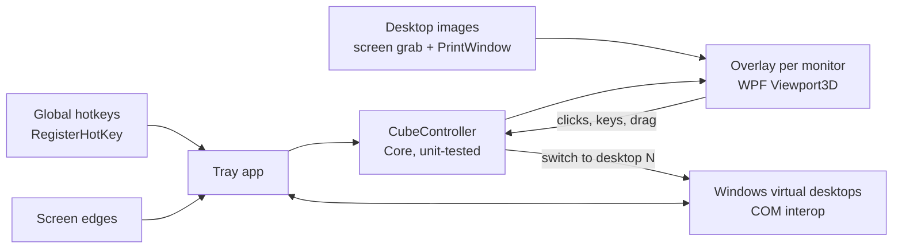

# The Cube

[](https://github.com/baverrr/The-Cube/actions/workflows/ci.yml)


A 3D desktop cube for Windows' own virtual desktops, modelled on KDE Plasma's Desktop Cube effect.
Press **Win+C**, spin the cube, and click a face to jump to that desktop.

> [!TIP]
> **Win+C** opens and closes the cube. **Ctrl+F1–F4** jump straight to desktops 1–4.

> [!WARNING]
> **Work in progress.** Phases 1–5 of 6 are done, but nothing has been tested on real Windows yet.
> Phase 6 is that test, with fixes, screenshots and a release. See [PLAN.md](PLAN.md).

Screenshots will be added once the cube runs on Windows (phase 6).

The Cube switches desktops through Windows interfaces that Microsoft doesn't document, and those
can change between Windows builds. On a build it doesn't recognise, The Cube shows a message
instead of switching.

## Contents

- [Quick start](#quick-start)
- [Features](#features)
- [Using it](#using-it)
- [Testing the current build](#testing-the-current-build)
- [Settings](#settings)
- [Troubleshooting](#troubleshooting)
- [How it works](#how-it-works)
- [Project layout](#project-layout)
- [Development](#development)
- [Known limitations](#known-limitations)
- [License and privacy](#license-and-privacy)

## Quick start

1. **Download** `TheCube.exe` from the latest CI run or release (Windows 10 22H2, or Windows 11 23H2, 24H2 or 25H2; x64). It's a single self-contained file, so you don't need to install .NET.
2. **Run it.** If SmartScreen warns about an unsigned app, choose **More info → Run anyway**. The Cube
   then sits in the notification area (tray), adds virtual desktops until you have 4, and starts with
   Windows from then on. You can turn that off in the tray menu.
3. **Press Win+C.**

To build it yourself, see [Development](#development).

## Features

- A cube with one face per Windows virtual desktop. It needs at least 3; with fewer, it offers to add one.
- The same motion as Plasma's cube: zooms out from your current desktop tilted 20° down, and zooms back into the face you pick.
- Drag to spin it, use the mouse wheel to zoom, or use the arrow keys to turn it one face at a time.
- Works with Windows' own desktops, so Task View, Win+Ctrl+←/→ and the taskbar stay in sync.
- Shows a cube on every monitor, each with its own part of every desktop. Picking a desktop on one monitor zooms every monitor into it.
- A plain colour or skybox image behind the cube, and optional screen-edge activation.

## Using it

| Key / action | What it does |
|---|---|
| **Win+C** | Open or close the cube |
| **Ctrl+F1 … Ctrl+F4** | Switch to desktop 1 … 4 |
| Drag | Spin the cube (tilt is limited to ±30°) |
| Mouse wheel | Zoom in or out |
| **←** / **→** | Turn one face left or right |
| **Enter**, **Space** | Go to the face in front |
| Click a face | Go to that desktop |
| Click empty space | Go to the face in front |
| **Esc** | Close without switching |

**Tray icon:** left-click opens the cube. Right-click for **Open cube**, **Settings…**, **Diagnostics…**,
**Start with Windows** and **Quit The Cube**. Starting `TheCube.exe` again while it's already running opens
Settings.

> Ctrl+F4 normally closes a tab or document in many Windows apps. The Cube takes it over by default
> to match the Plasma set-up. Change `SwitchToDesktopHotkeys` if you want it back.

## Testing the current build

**Diagnostics…** in the tray menu opens a window for checking The Cube on your PC. It also opens
by itself at start-up if something's wrong. It shows:

- your Windows build and which set of desktop interfaces The Cube picked for it
- whether each hotkey was registered, which ones fall back to the keyboard hook, and why any couldn't be set up
- your desktops, with ▶ marking the current one. This updates live when you switch with Win+Ctrl+←/→.
- **Open cube** (the same as Win+C), **Switch** buttons, **Add desktop**, **Settings…** and **Open settings file**
- **Preview desktop images**: the picture each cube face would show, with one row per monitor and one column per desktop. Each one says how it was made:
  - the current desktop is a *screen grab*
  - on other desktops, windows are *live* (captured just now), *cached* (couldn't be captured now, so their last good image is used) or *missing* (never captured)

Try Win+C (or **Open cube**) and Ctrl+F1–F4 from any app. Ctrl+F1–F4 should play Windows' slide animation
and give focus to the top window on the new desktop.

**Getting a test build:** open the latest [CI run](https://github.com/baverrr/The-Cube/actions/workflows/ci.yml)
and download the `TheCube-win-x64` artifact. Windows SmartScreen will warn about an unsigned app:
choose **More info → Run anyway**.

## Settings

Open **Settings…** from the tray menu. Changes apply as soon as you press **Save**:

- **General:** start with Windows, and how many desktops to keep.
- **Shortcuts:** click a box and press the keys; Backspace clears it.
- **Cube:** background colour or skybox, face displacement, distance factor, animation length, and inverted dragging.
- **Screen edges:** which edges and corners open the cube when the pointer rests on them for 150 ms.

Settings are stored in `%APPDATA%\The Cube\settings.json`, which you can also edit by hand while The Cube isn't running. The defaults match the Plasma set-up this app is modelled on:

| Setting | Default | Meaning |
|---|---|---|
| `FaceDisplacement` | `100` | Extra gap between the cube's centre and each face (px) |
| `DistanceFactor` | `1.75` | How far the camera pulls back when the cube opens |
| `MouseInvertedX` / `MouseInvertedY` | `false` | Reverse drag direction |
| `Background` | `Color` | `Color` or `SkyBox` |
| `BackgroundColor` | `#212427` | Colour behind the cube |
| `SkyBox` | — | Image path for the `SkyBox` background |
| `BorderActivate` | `[]` | Screen edges that open the cube, e.g. `["TopLeft"]` |
| `AnimationDurationMs` | `566` | Open, close and rotate animation length |
| `StartWithWindows` | `true` | Start when you sign in (a per-user `Run` registry entry) |
| `EnsureDesktopCount` | `4` | Add desktops at start-up until there are this many (`0` = leave alone) |
| `ToggleCubeHotkey` | `Win+C` | Open/close hotkey |
| `SwitchToDesktopHotkeys` | `Ctrl+F1`…`Ctrl+F4` | One entry per desktop; `""` = unbound |

## Troubleshooting

| Problem | Fix |
|---|---|
| Win+C opens Copilot instead | Windows kept the shortcut. The Cube catches it with a keyboard hook instead; **Diagnostics…** shows whether that's active. If it still doesn't work, choose another shortcut in **Settings…**. |
| "Windows build … isn't supported" | Your build uses desktop interfaces The Cube doesn't know yet. Please open an issue with the build number from **Diagnostics…**. |
| Some windows are missing from other desktops' faces | Those apps can't be captured while hidden. Visit that desktop once and they'll appear from then on. |
| It doesn't start with Windows after moving `TheCube.exe` | The start-up entry points to the old location. Untick and tick **Start with Windows** again. |
| The cube opens and immediately closes, or stops opening | Please send `%APPDATA%\The Cube\cube.log` (**Diagnostics… → Open log**). It records each open and close, and what had focus at the time. |
| Something went wrong | Details are in `%APPDATA%\The Cube\error.log`. |

To remove The Cube: untick **Start with Windows**, quit it, delete `TheCube.exe`, and delete `%APPDATA%\The Cube`.

## How it works



<details>
<summary>The details</summary>

- **Geometry.** With *n* desktops, the faces form an *n*-sided prism around the vertical axis, each face
  the size of the screen. Face *i* sits at azimuth `i·360/n` and distance
  `½·width / tan(180°/n) + FaceDisplacement` from the centre.
- **Camera.** The camera orbits the centre, always looking at it, with a 60° vertical field of view.
  - **Closed:** the current face exactly fills the screen.
  - **Open:** the camera is `FaceDistance × DistanceFactor` back and tilted 20° down.
  - Moves between poses use quaternion slerp with OutCubic easing.
- **Picking a desktop.** The face in front is the one nearest the camera's azimuth, rounding half up.
- **Desktop images.**
  - The current desktop is captured just before the cube appears.
  - Other desktops are built from the wallpaper plus each window's own image, stacked in z-order. Where a window can't be captured, The Cube uses the last snapshot of that desktop.

</details>

## Project layout

```
src/TheCube.Core/     Platform-neutral logic: geometry, camera, animation, controller, hotkeys, settings
src/TheCube.App/      WPF app: start-up, hotkeys, diagnostics window
  CubeSession.cs      Opens a cube on every monitor, keeps them in step, switches desktop at the end
  CubeOverlay.cs      Full-screen window per monitor: 3D cube (Viewport3D), mouse/keyboard input, placeholder
  TrayIcon.cs         Tray icon and menu, app icon, Start with Windows
  SettingsWindow.cs   Settings dialog
  HotkeyManager.cs    Global hotkeys (RegisterHotKey); KeyboardHook.cs is the fallback for ones Windows keeps
  EdgeWatcher.cs      Screen-edge activation
  Assets/             Icon (SVG source + .ico)
  DesktopImages.cs    Builds each desktop's picture per monitor; FaceRenderer turns it into a face brush
  Interop/            Virtual desktop COM interfaces (one set per Windows version), screen/window
                      capture, monitors, IDesktopWallpaper, Win32 calls
tests/TheCube.Core.Tests/  xUnit tests for Core (run on any OS)
.github/workflows/     CI: build, test, publish win-x64 exe on windows-latest
PLAN.md                Phases and what's left
```

## Development

You need the [.NET 10 SDK](https://dotnet.microsoft.com/download). The WPF app builds on Linux too (`EnableWindowsTargeting`), but it only runs on Windows.

```sh
dotnet build TheCube.slnx
dotnet test TheCube.slnx
dotnet publish src/TheCube.App -c Release -r win-x64 --self-contained -p:PublishSingleFile=true -p:EnableCompressionInSingleFile=true -p:IncludeNativeLibrariesForSelfExtract=true -p:DebugType=none -o publish
```

## Known limitations

- The desktop-switching interfaces are undocumented and change between Windows builds. Supported:
  Windows 10 21H2/22H2 (19044–19045), Windows 11 22H2/23H2 (22621–22631, updated since August 2023) and
  24H2/25H2 (26100+). Newer builds are tried with the 24H2 interfaces. If Windows has changed them, the app
  shows a message instead of crashing. Windows Server and Windows 11 21H2 aren't supported.
- If Explorer restarts, The Cube reconnects automatically.
- `Ctrl+F1–F4` use Windows' slide animation on Windows 11. Windows 10 has no animated switch.
- Windows has no live view of other desktops. Their faces are composed when the cube opens, from the wallpaper,
  the taskbar and each window as Windows renders it (`PrintWindow`). Some GPU-rendered apps (games, some
  browsers and video players) can't be captured that way. They show their last good image if they were ever
  captured, and are left out otherwise. Minimized windows are left out, as in Plasma.
- Desktop icons aren't drawn on other desktops' faces.
- The skybox background is an approximation: a 360°×180° panorama image that pans as the cube turns,
  rather than a true 3D environment.
- Faces of other desktops fill in a moment after the cube opens; until then they're plain grey.
- Windows may already use Win+C for Copilot. The Cube then falls back to a keyboard hook, and you can pick another hotkey in settings.
- Screen edges are ignored while a full-screen app is in front, as in Plasma.

## License and privacy

MIT — see [LICENSE](LICENSE). The behaviour is modelled on KDE's GPL-licensed KWin cube effect,
but no KWin code is used. The virtual desktop interface definitions are adapted from
[MScholtes/VirtualDesktop](https://github.com/MScholtes/VirtualDesktop) (MIT); see
[THIRD-PARTY-NOTICES.md](THIRD-PARTY-NOTICES.md).

The Cube makes no network connections and collects nothing. Desktop images stay in memory and are never
written to disk. `cube.log` stays on your PC. It records what The Cube did, plus window class and process
names (never window titles), and is capped at 1 MB.
