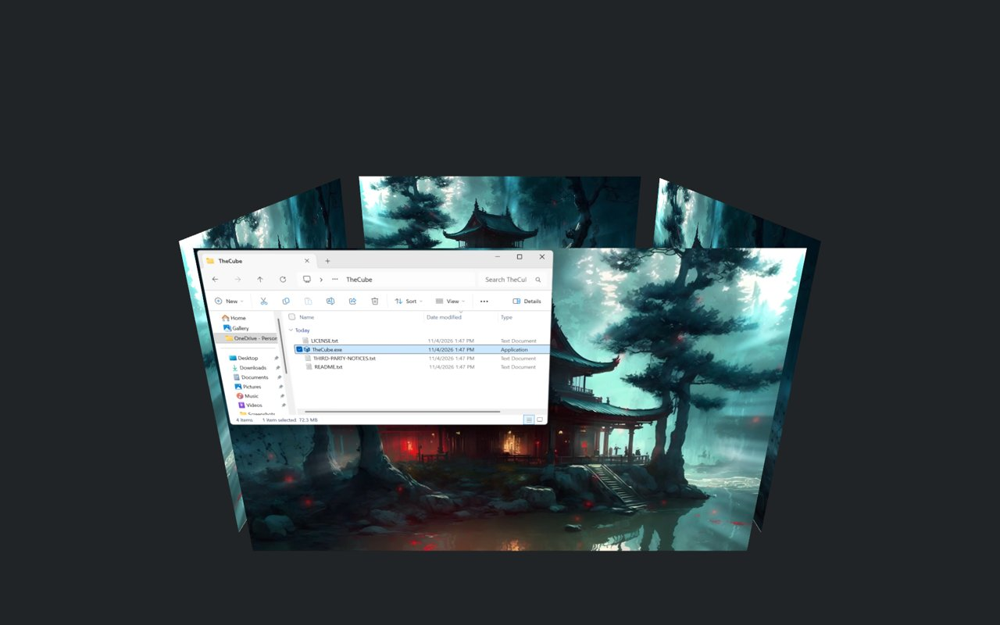
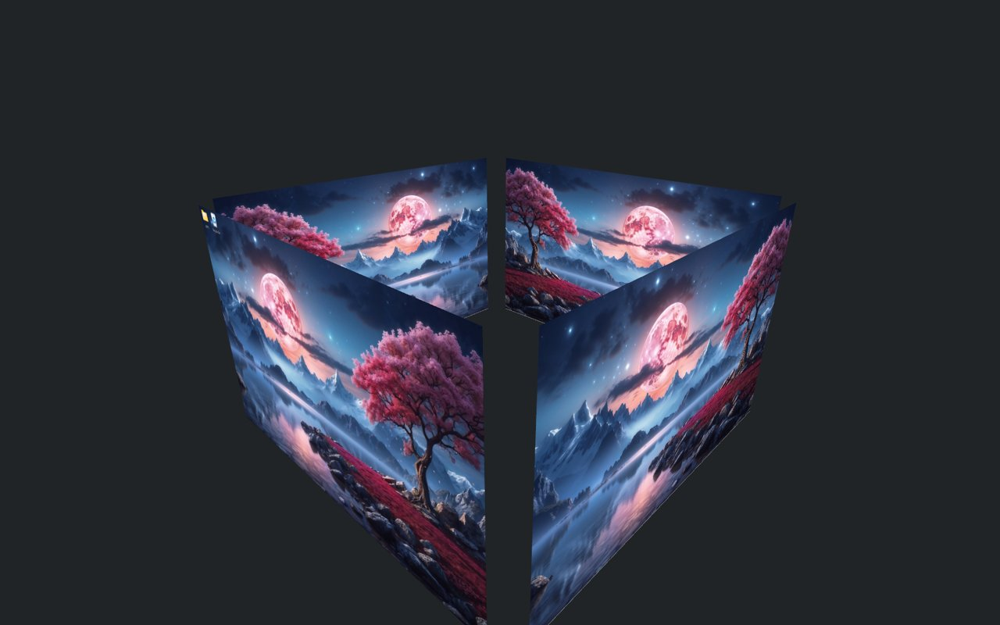
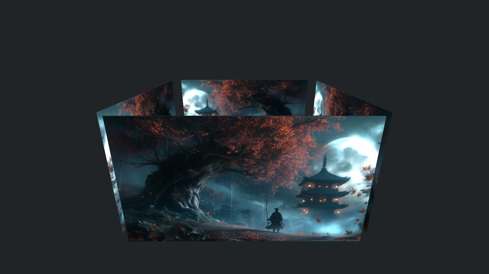
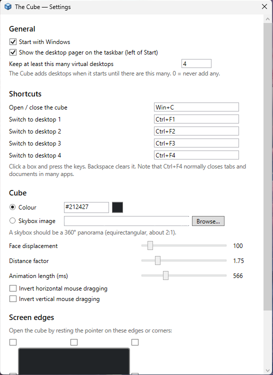
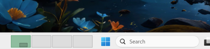

# The Cube

[](https://github.com/baverrr/The-Cube/actions/workflows/ci.yml)


[](LICENSE)

A 3D desktop cube for Windows' own virtual desktops, modelled on KDE Plasma's Desktop Cube effect. Press Win+C, spin the cube, and click a face to jump to that desktop.

<p align="center">
  
</p>

> [!TIP]
> Win+C opens and closes the cube. Ctrl+F1 to Ctrl+F4 jump straight to desktops 1 to 4, or click a box in the pager just left of the Start button.

> [!IMPORTANT]
> Early release, tested on one Windows 11 PC so far. The Cube uses Windows interfaces that Microsoft doesn't document, and they can change between Windows builds. On a build it doesn't know, it shows a message instead of switching. See [PLAN.md](PLAN.md).

**[What it does](#what-it-does)** · **[What you need](#what-you-need)** · **[Install](#install)** · **[How to use it](#how-to-use-it)** · **[Help](#help)**

## What it does

- **One face per desktop.** Uses Windows' own virtual desktops, so Task View, Win+Ctrl+←/→ and the taskbar stay in sync. It needs at least 3 desktops and offers to add one if you have fewer.
- **Plasma's motion.** Zooms out from your desktop tilted 20° down, and zooms back into the face you pick.
- **Mouse or keys.** Drag to spin, scroll to zoom, or use the arrow keys to turn one face at a time.
- **Every monitor.** Each monitor gets its own cube. Picking a desktop on one moves them all.
- **Taskbar pager.** One box per desktop, just left of Start, with its windows outlined. Click or scroll over it to switch.
- **Animated wallpapers.** Works with apps like Lively Wallpaper and Wallpaper Engine.
- **Stays on your PC.** No network connections and nothing collected.

<table>
  <tr>
    <td></td>
    <td></td>
  </tr>
  <tr>
    <td align="center">Spinning the cube</td>
    <td align="center">A second monitor</td>
  </tr>
  <tr>
    <td align="center"></td>
    <td align="center"></td>
  </tr>
  <tr>
    <td align="center">Settings</td>
    <td align="center">The taskbar pager</td>
  </tr>
</table>

## What you need

- Windows 10 21H2 or 22H2, or Windows 11 22H2, 23H2, 24H2 or 25H2, on x64
- Nothing else. The exe is self-contained, so you don't need to install .NET

## Install

1. Download `TheCube.exe` from the latest [release](https://github.com/baverrr/The-Cube/releases) or [CI run](https://github.com/baverrr/The-Cube/actions/workflows/ci.yml) (the `TheCube-win-x64` artifact). It's one file of about 190 MB.

2. Unblock it. The exe isn't code-signed yet, so Windows warns about it. Right-click it, choose Properties, tick Unblock and press OK. Or in PowerShell:

   ```powershell
   Unblock-File .\TheCube.exe
   ```

   You can also choose More info, then Run anyway, when Windows warns you.

3. Run it. The first time, it asks before adding desktops (up to 4) and starting with Windows. It then sits in the notification area.

4. Press Win+C.

## How to use it

| Key or action | What it does |
|---|---|
| Win+C | Open or close the cube |
| Ctrl+F1 to Ctrl+F4 | Switch to desktop 1 to 4 |
| Drag | Spin the cube (tilt is limited to ±30°) |
| Mouse wheel | Zoom in or out |
| ← / → | Turn one face left or right |
| Enter, Space, or click empty space | Go to the face in front |
| Click a face | Go to that desktop |
| Esc | Close without switching |
| Click or scroll over the pager | Go to that desktop, or the next or previous one |

The tray icon opens the cube on left-click. Right-click it for Settings, Diagnostics, Start with Windows and Quit. Running `TheCube.exe` again while it's open also opens Settings.

Ctrl+F4 usually closes a tab in many apps. The Cube takes it over by default. Change `SwitchToDesktopHotkeys` to get it back.

<details>
<summary><b>Settings</b></summary>

Open Settings from the tray menu. Changes apply when you press Save. You can pick shortcuts, the cube's colour or a skybox image, animation length, and which screen edges or corners open the cube. Settings are saved in `%APPDATA%\The Cube\settings.json`, which you can edit while The Cube isn't running.

| Setting | Default | Meaning |
|---|---|---|
| `FaceDisplacement` | `100` | Extra gap between the cube's centre and each face (px) |
| `DistanceFactor` | `1.75` | How far the camera pulls back when the cube opens |
| `MouseInvertedX` / `MouseInvertedY` | `false` | Reverse drag direction |
| `Background` / `BackgroundColor` / `SkyBox` | `Color` / `#212427` / none | Plain colour or a skybox image behind the cube |
| `BorderActivate` | `[]` | Screen edges that open the cube, e.g. `["TopLeft"]` |
| `AnimationDurationMs` | `566` | Open, close and rotate animation length |
| `StartWithWindows` | `true` | Start when you sign in |
| `ShowPager` | `true` | Show the pager on every taskbar |
| `EnsureDesktopCount` | `4` | Add desktops at start-up until there are this many (`0` = leave alone) |
| `ToggleCubeHotkey` | `Win+C` | Open/close hotkey |
| `SwitchToDesktopHotkeys` | `Ctrl+F1`…`Ctrl+F4` | One entry per desktop; `""` = unbound |
</details>

## Help

**Win+C opens Copilot instead.** The Cube then uses a keyboard hook. Diagnostics shows whether it's on. If it still fails, pick another shortcut in Settings.

**The cube feels slow to open.** It keeps its windows ready between opens, so it shows up about 0.2 s after Win+C, then zooms out. For a quicker zoom, lower Animation length in Settings (about 250-300 ms).

**"Windows build … isn't supported".** Please open an issue with the build number from Diagnostics.

**Some windows are missing from other desktops' faces.** Some apps (games, some browsers and video players) can't be captured while hidden. Visit that desktop once and they'll show from then on. Minimized windows and desktop icons are never shown.

**It doesn't start with Windows after moving the exe.** Untick and tick Start with Windows again.

**The cube or the pager misbehaves.** Send `%APPDATA%\The Cube\cube.log` (Diagnostics, then Open log). Errors are in `error.log` in the same folder.

**Removing it.** Untick Start with Windows, quit, then delete `TheCube.exe` and `%APPDATA%\The Cube`.

<details>
<summary><b>For developers</b></summary>

- Build and test with the [.NET 10 SDK](https://dotnet.microsoft.com/download). It builds on Linux too, but only runs on Windows:

  ```sh
  dotnet build TheCube.slnx
  dotnet test TheCube.slnx
  dotnet publish src/TheCube.App -c Release -r win-x64 --self-contained -p:PublishSingleFile=true -p:PublishReadyToRun=true -p:IncludeNativeLibrariesForSelfExtract=true -p:DebugType=none -o publish
  ```

- Logic (geometry, camera, settings) is in [src/TheCube.Core](src/TheCube.Core), the WPF app in [src/TheCube.App](src/TheCube.App), and the Windows desktop interfaces in [Interop/](src/TheCube.App/Interop)
- How it fits together: [architecture diagram](docs/diagrams/architecture.svg)
- Supported builds: 19044–19045, 22621–22631 (updated since August 2023) and 26100+. Newer builds try the 24H2 interfaces. Windows Server and Windows 11 21H2 aren't supported
- Diagnostics in the tray menu shows the interfaces picked, hotkey status and a preview of every face
- What's left to do: [PLAN.md](PLAN.md). Signing setup: [docs/SIGNING.md](docs/SIGNING.md)
</details>

## License

MIT. See [LICENSE](LICENSE). The behaviour is modelled on KDE's KWin cube effect, but no KWin code is used. The virtual desktop interface definitions are adapted from [MScholtes/VirtualDesktop](https://github.com/MScholtes/VirtualDesktop) (MIT). See [THIRD-PARTY-NOTICES.md](THIRD-PARTY-NOTICES.md).

Privacy: desktop images stay in memory and are never saved. `cube.log` stays on your PC, records window class and process names but never window titles, and is rotated at 1 MB.

<details>
<summary><b>Code signing policy</b></summary>

- Releases are built only by GitHub Actions from this repository ([release workflow](.github/workflows/release.yml)), on GitHub-hosted runners. Nothing is built or signed on anyone's own PC.
- Releases are not signed yet. The project is preparing to apply to [SignPath Foundation](https://signpath.org/) for free open-source code signing. Once accepted, signed releases will say: *Free code signing provided by [SignPath.io](https://about.signpath.io/), certificate by [SignPath Foundation](https://signpath.org/).*
- Committers and reviewers: [baverrr](https://github.com/baverrr). Approvers (each release must be approved before it's signed): [baverrr](https://github.com/baverrr)
- This program will not transfer any information to other networked systems unless specifically requested by the user or the person installing or operating it.
- On first run, The Cube asks before it adds virtual desktops or a start-up entry. Both can be changed in Settings.
</details>
