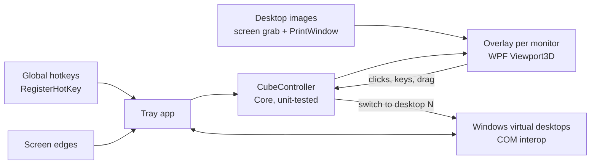

# The Cube

[](https://github.com/baverrr/The-Cube/actions/workflows/ci.yml)


A 3D desktop cube for Windows' own virtual desktops, modelled on KDE Plasma's Desktop Cube effect.
Press **Win+C**, spin the cube, and click a face to jump to that desktop.

> [!TIP]
> **Win+C** opens and closes the cube. **Ctrl+F1–F4** jump straight to desktops 1–4.

> [!WARNING]
> **Work in progress.** Phase 1 of 6 is done: the cube's math and logic are written and
> unit-tested, but the Windows app doesn't do anything yet. See [PLAN.md](PLAN.md).

Screenshots will be added once the cube runs on Windows (phase 6).

The Cube switches desktops through Windows interfaces that Microsoft doesn't document, and those
can change between Windows builds. On a build it doesn't recognise, The Cube shows a message
instead of switching.

## Contents

- [Quick start](#quick-start)
- [Features](#features)
- [Using it](#using-it)
- [Settings](#settings)
- [How it works](#how-it-works)
- [Project layout](#project-layout)
- [Development](#development)
- [Known limitations](#known-limitations)
- [License and privacy](#license-and-privacy)

## Quick start

1. **Download** `TheCube.exe` from the latest CI run or release (Windows 10 22H2 or Windows 11, x64).
2. **Run it.** It sits in the system tray and makes sure you have at least 4 virtual desktops.
3. **Press Win+C.**

To build it yourself, see [Development](#development).

## Features

- A cube with one face per Windows virtual desktop. It needs at least 3; with fewer, it offers to add one.
- The same motion as Plasma's cube: zooms out from your current desktop tilted 20° down, and zooms back into the face you pick.
- Drag to spin it, use the mouse wheel to zoom, or use the arrow keys to turn it one face at a time.
- Works with Windows' own desktops, so Task View, Win+Ctrl+←/→ and the taskbar stay in sync.
- Shows a window on every monitor, each with its own part of every desktop.
- A plain colour or skybox image behind the cube, and optional screen-edge activation.

## Using it

| Key / action | What it does |
|---|---|
| **Win+C** | Open or close the cube |
| **Ctrl+F1 … Ctrl+F4** | Switch to desktop 1 … 4 |
| Drag | Spin the cube (tilt is limited to ±30°) |
| Mouse wheel | Zoom in or out |
| **←** / **→** | Turn one face left or right |
| **Enter**, **Space** | Go to the face in front |
| Click a face | Go to that desktop |
| Click empty space | Go to the face in front |
| **Esc** | Close without switching |

> Ctrl+F4 normally closes a tab or document in many Windows apps. The Cube takes it over by default
> to match the Plasma set-up. Change `SwitchToDesktopHotkeys` if you want it back.

## Settings

Settings are stored in `%APPDATA%\The Cube\settings.json`. The defaults match the Plasma set-up this app is modelled on:

| Setting | Default | Meaning |
|---|---|---|
| `FaceDisplacement` | `100` | Extra gap between the cube's centre and each face (px) |
| `DistanceFactor` | `1.75` | How far the camera pulls back when the cube opens |
| `MouseInvertedX` / `MouseInvertedY` | `false` | Reverse drag direction |
| `Background` | `Color` | `Color` or `SkyBox` |
| `BackgroundColor` | `#212427` | Colour behind the cube |
| `SkyBox` | — | Image path for the `SkyBox` background |
| `BorderActivate` | `[]` | Screen edges that open the cube, e.g. `["TopLeft"]` |
| `AnimationDurationMs` | `566` | Open, close and rotate animation length |
| `EnsureDesktopCount` | `4` | Add desktops at start-up until there are this many (`0` = leave alone) |
| `ToggleCubeHotkey` | `Win+C` | Open/close hotkey |
| `SwitchToDesktopHotkeys` | `Ctrl+F1`…`Ctrl+F4` | One entry per desktop; `""` = unbound |

## How it works



<details>
<summary>The details</summary>

- **Geometry.** With *n* desktops, the faces form an *n*-sided prism around the vertical axis, each face
  the size of the screen. Face *i* sits at azimuth `i·360/n` and distance
  `½·width / tan(180°/n) + FaceDisplacement` from the centre.
- **Camera.** The camera orbits the centre, always looking at it, with a 60° vertical field of view.
  - **Closed:** the current face exactly fills the screen.
  - **Open:** the camera is `FaceDistance × DistanceFactor` back and tilted 20° down.
  - Moves between poses use quaternion slerp with OutCubic easing.
- **Picking a desktop.** The face in front is the one nearest the camera's azimuth, rounding half up.
- **Desktop images.**
  - The current desktop is captured just before the cube appears.
  - Other desktops are built from the wallpaper plus each window's own image, stacked in z-order. Where a window can't be captured, The Cube uses the last snapshot of that desktop.

</details>

## Project layout

```
src/TheCube.Core/     Platform-neutral logic: geometry, camera, animation, controller, hotkeys, settings
src/TheCube.App/      WPF tray app, overlay, Windows interop
tests/TheCube.Core.Tests/  xUnit tests for Core (run on any OS)
.github/workflows/     CI: build, test, publish win-x64 exe on windows-latest
PLAN.md                Phases and what's left
```

## Development

You need the [.NET 10 SDK](https://dotnet.microsoft.com/download). The WPF app builds on Linux too (`EnableWindowsTargeting`), but it only runs on Windows.

```sh
dotnet build TheCube.slnx
dotnet test TheCube.slnx
dotnet publish src/TheCube.App -c Release -r win-x64 --self-contained -p:PublishSingleFile=true -o publish
```

## Known limitations

- The desktop-switching interfaces are undocumented and change between Windows builds. Supported builds are listed in the interop code.
- Windows can't render live images of windows on other desktops. Those faces show composed or cached images, and some GPU-rendered apps may appear black or out of date.
- Windows may already use Win+C for Copilot. The Cube then falls back to a keyboard hook, and you can pick another hotkey in settings.

## License and privacy

MIT — see [LICENSE](LICENSE). The behaviour is modelled on KDE's GPL-licensed KWin cube effect,
but no KWin code is used.

The Cube makes no network connections and collects nothing. Desktop images stay in memory and are never written to disk.
